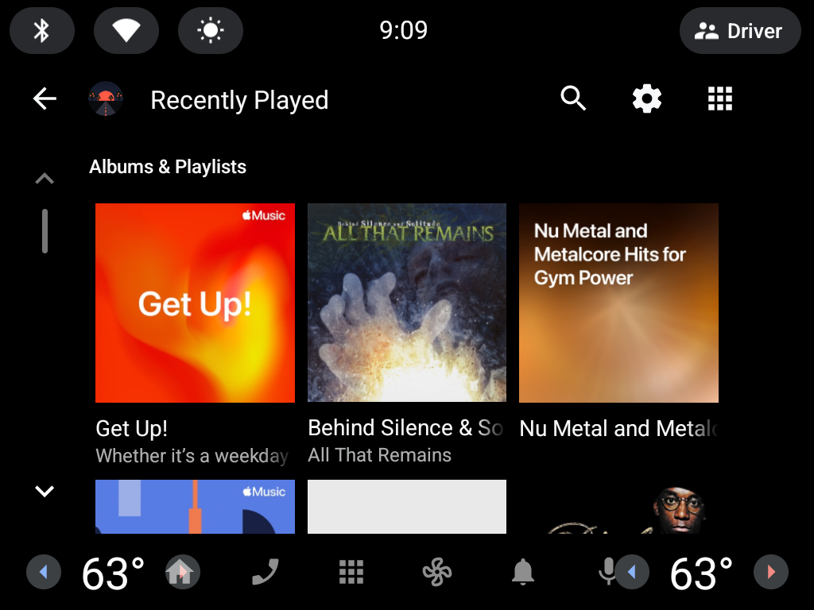
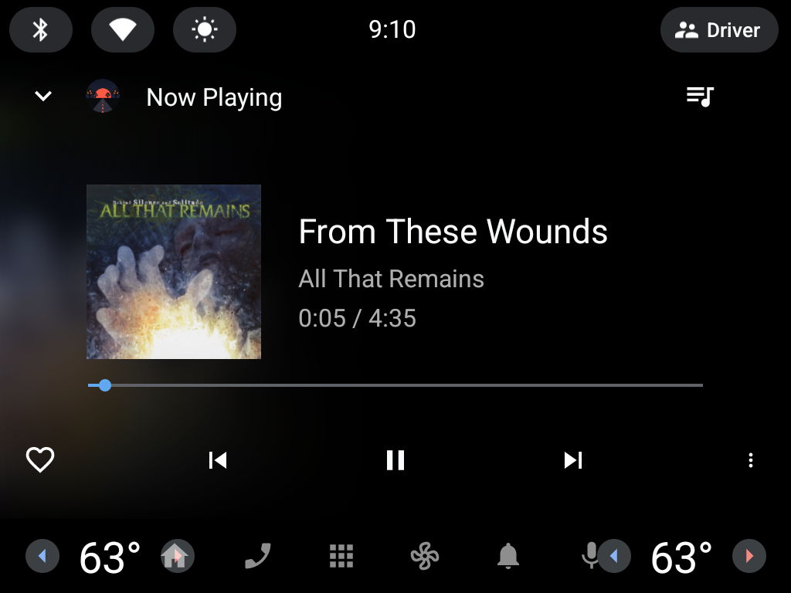

  

<h1 align="center">Orchard Drive</h1>

  <b>Your Apple Music library, built into your car.</b> 
  An Apple Music player for cars with Google built-in (Android Automotive). No phone, CarPlay or Bluetooth needed.

  
  

  
  

> **Beta:** Orchard Drive is in closed testing on Google Play. Expect rough edges, and please report them!

## Features

- **Sign in with your phone.** Scan a QR code on the car screen and sign in to Apple Music on your phone. No typing on the car screen.
- **Home:** Recently Played, Made for You, Recommended, Heavy Rotation, Recently Added and Top Charts.
- **Your library:** playlists, artists, albums and songs, shown as artwork tiles or a list. Big libraries get A–Z folders.
- **Search** the whole Apple Music catalog.
- **Works like a built-in app.** Plays in the car's own media screen, with steering-wheel buttons and the driver display.
- **Picks up where you left off** when you get back in the car.
- Shuffle, repeat, Love, Dislike and Add to Library.
- Choose high-quality streaming (256 kbps) or save data on cellular.

## What you need

- A car with **Google built-in** (Android Automotive with the Play Store). Tested on a Polestar 4.
- An active **Apple Music subscription**.

## Getting it

During the beta, Orchard Drive is only available through Google Play testing. To join, contact me
(see [Feedback](#feedback--support)). Once you're added, find **Orchard Drive** in your car's Play Store.

After installing:
1. Open **Media** in your car and choose **Orchard Drive**.
2. Tap **Sign in**. The car shows a QR code and a short code.
3. Scan the QR code with your phone (or enter the code at the address shown) and sign in with your Apple ID.
4. Your library appears in the car within a few seconds.

### What about sideloading an APK?

Most production cars, including Polestar and Volvo, block installing apps from outside the Play Store,
so an APK won't install on them. Google Play is the way to get Orchard Drive on a real car.

## Known limitations

- **No Lossless.** Music streams in AAC (256 kbps on high quality).
- **iCloud uploads and some purchased-only tracks can't play.** Apple doesn't stream them to this kind of app, so they're hidden.
- **Settings are only available while parked.** Your car blocks that screen while driving; browsing and playback work as normal.
- When you start a new song, you might hear a split second of the previous one.

## Feedback & support

Found a bug? In the car, go to **Settings**, tap **Version** 7 times, open **Diagnostics** and tap
**Send debug report**. Then [open an issue](https://github.com/dverba/OrchardDrive/issues) with the
report ID and what happened.

Orchard Drive is a one-person side project. If it makes your drive better, you can
[buy me a coffee](https://buymeacoffee.com/thisisnotdave) ☕

## Privacy

Orchard Drive talks only to Apple Music and its own sign-in service. It has no ads and no tracking.
Debug reports are sent only when you tap the button. Full policy:
[privacy policy](https://dverba.github.io/aaosmusic-signin/privacy.html).

## For developers

Building, running on the emulator, feature flags and project layout are in
[docs/DEVELOPMENT.md](docs/DEVELOPMENT.md). Design notes are in [docs/ARCHITECTURE.md](docs/ARCHITECTURE.md).

Apple's MusicKit SDK isn't in this repo; see [docs/APPLE_MUSIC_SETUP.md](docs/APPLE_MUSIC_SETUP.md) for how to get it.

## License

[MIT](LICENSE). This covers this repository's code only: Apple's MusicKit SDK is not included and
stays under Apple's terms. Orchard Drive is not affiliated with or endorsed by Apple. Apple Music is a
trademark of Apple Inc.
